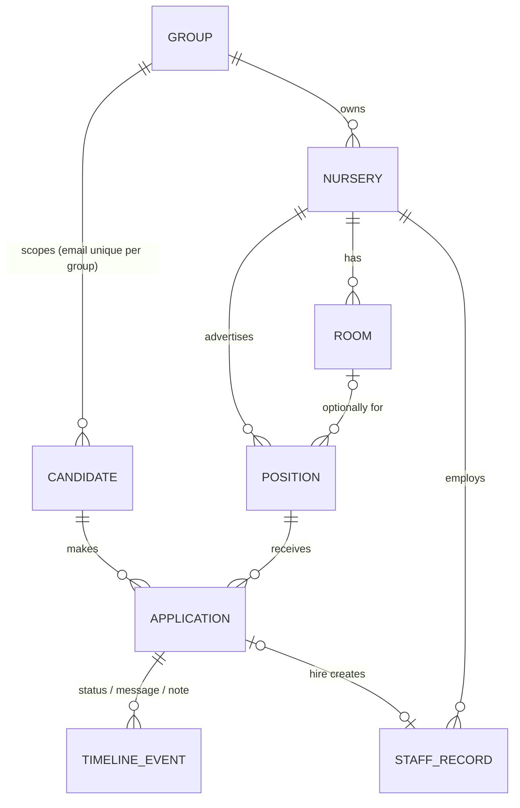
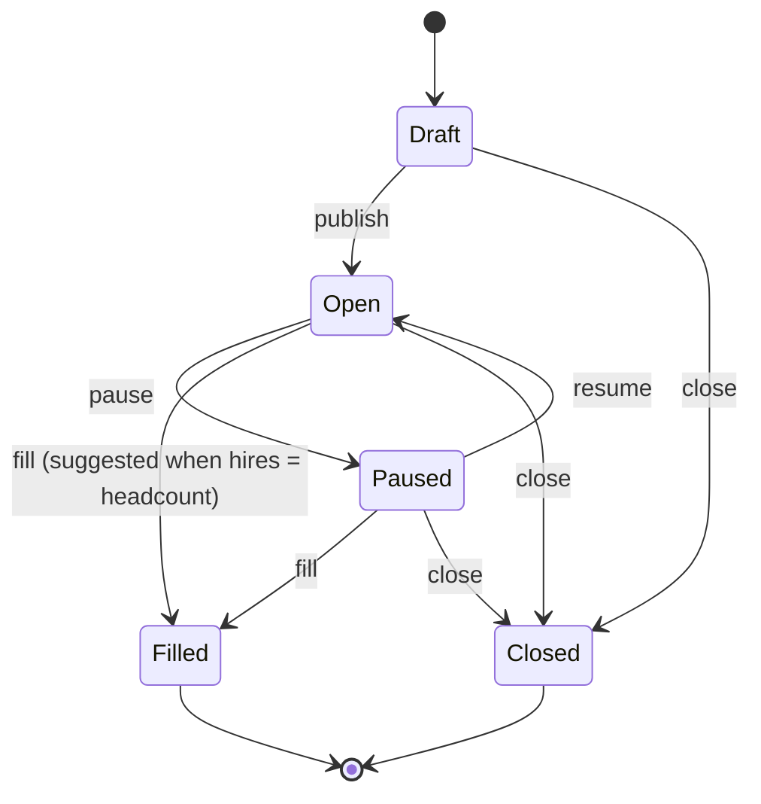
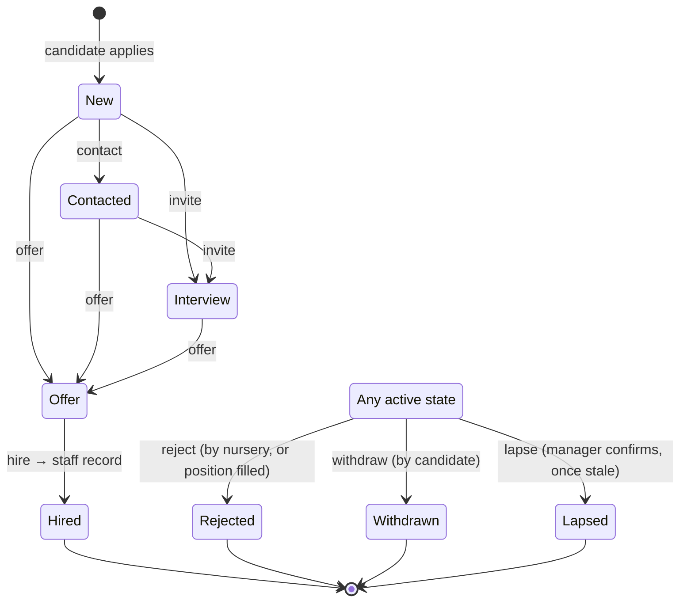

# Recruitment portal: a Famly prototype

**Live prototype:** https://luishdosreis.github.io/famly-hire-me/ (no login; data lives in your browser, and "Reset" in the top bar restores it)
**The brief:** [docs/BRIEF.md](docs/BRIEF.md)

> One page to apply. One queue to reply. A hire becomes a staff record without retyping.

Every nursery gets a public page where a job seeker applies from their phone in about two minutes, with no account. The manager gets one queue inside Famly, sorted by who has waited longest for a reply. Every action sends a message, and hiring creates the Famly staff record already filled in.

---

## Contents

1. [Try it in 10 minutes](#try-it-in-10-minutes)
2. [How I framed the problem](#how-i-framed-the-problem)
3. [Question 1: the portal](#question-1-the-portal)
4. [Question 2: the manager's side and the model](#question-2-the-managers-side-and-the-model)
5. [Decisions and what I rejected](#decisions-and-what-i-rejected)
6. [How we'd know it worked](#how-wed-know-it-worked)
7. [Shortcuts](#shortcuts)
8. [What I'd do next](#what-id-do-next)
9. [Process, AI use and time](#process-ai-use-and-time)
10. [Running it locally](#running-it-locally)

---

## Try it in 10 minutes

The top bar switches between **Job seeker** and **Manager**, moves the clock forward (**+1 day**) and **Reset**s the data. It works best with the job seeker in one tab (narrow the window or use device mode) and the manager in another. The two tabs stay in sync live.

1. **Apply as a job seeker.** On Oak Tree Nursery's page, open *Level 3 Practitioner* and apply. Keep the status link open.
2. **Reply as the manager.** Your application is in *Applicants* with a qualification badge. Amira Khan sits above it with a red *Waiting 52h*. Click **Contact** or **Invite to interview** on your row: the message is prefilled and editable. Your status tab updates on its own.
3. **Hire.** Make an offer, then **Hire**. Confirm the prefilled staff record, and you're asked straight away to mark the position filled. Four people are still waiting; they each get a message, and their status pages say *Not progressing*.
4. **Same person, two sites.** Amira has also applied to Willow House in the same group. Her row says so, and her panel names the other manager.
5. **Gone quiet.** Marcus Bell hasn't responded in 6 days and is flagged *Gone quiet*. Press **+1 day** a few times to watch the waits grow and others go quiet, then **Mark as lapsed**.

The seed data follows [docs/USER_JOURNEYS.md](docs/USER_JOURNEYS.md): one group (Acorn Family Nurseries), three nurseries, six positions and thirteen applications, each chosen to show one behaviour.

---

## How I framed the problem

The brief gives one fact (Famly holds a **staff record**) and one hunch (**first-reply speed matters most**). Everything else follows from reading the "what happens today" table as a funnel that leaks at every step:

| Leak | Root cause | What the prototype does |
|---|---|---|
| Nobody can point a curious person anywhere | No stable address | One public URL per nursery, showing only what's open right now |
| Applying means an email address or a printed form | High friction, on a phone, on a break | One screen, about two minutes, no account, no CV |
| "Reads a CV and guesses" | Unstructured input | Qualification is a structured answer, matched against the requirement |
| Eleven arrive at once; the strong ones take another job first | No sense of who has waited longest | The queue is sorted by wait time for a first reply, with amber and red thresholds |
| Three sites, three conversations | Identity per inbox, not per person | One candidate per group, matched by email |
| "Does not reply to everybody" | Replying costs effort | Every action sends a templated message; filling a position notifies everyone left |
| The hire gets typed into Famly by hand | Two systems | Hiring creates the staff record, prefilled |

The **manager's time** is the scarce resource: hiring is their fourth job. So every screen answers one question: *who do I need to reply to, and what's the one click?*

**Users:**

- **The job seeker**: on a phone, no account, sceptical.
- **The nursery manager**: signed into Famly, time-poor.
- **The group manager**: secondary here. Their need (one person, several sites) is served through the candidate model rather than a separate view.

---

## Question 1: the portal

> *What do they touch, and what are they in your system?*

**What they touch:** four screens, all phone-first.

1. **Nursery page** (`/n/oak-tree`): who the nursery is and the open roles. Each role shows room and age group, qualification, hours and pay up front.
2. **Position page**: the role, plus *what happens when you apply*. That section is there to earn trust: no account, you get a private link, and the manager replies directly.
3. **Apply form**, one screen:
   - name, email and mobile
   - qualification: none / working towards / Level 2 / Level 3
   - earliest start and hours
   - right to work
   - an optional note

   There's no CV and no password. Errors show inline and clear as you fix them. If the same email applies to the same role again, it gets its existing link back.
4. **Confirmation and private status page**: the status link is their only "account". The page shows a plain-language status (*Received → Being reviewed → Invited to interview → Offer → Hired*, or *Not progressing* / *Closed*) and every message the nursery sent.

**What they are in our system:** a **Candidate**. That is not a user account and not a staff record. A Candidate is identified by email and **scoped to the group**:

- The same person applying to three Acorn sites is one candidate, so the managers can see it.
- They are never visible to a different group. Nursery groups compete for the same staff.

Each application gets its own unguessable status token. The candidate never sees internal states or notes: a single projection function is the only path from internal state to the public page, and it's covered by tests.

---

## Question 2: the manager's side and the model

> *What does the manager open, and what model carries a position from open to filled, and an application from arrival to hired, rejected or gone quiet?*

**What they open:** *Recruitment* in the Famly sidebar, next to *Staff*.

- **Overview**: a banner showing how many people are waiting for a first reply, a metrics strip, and every position with *needs reply / in progress / hired of headcount*.
- **Applicants** (the working view): one queue across positions.
  - It's grouped *Waiting for a first reply → In progress → Hired & closed*, and within each group whoever has waited longest comes first.
  - Every row shows qualification match, right to work, other sites in the group, wait time or *Gone quiet*, and status.
  - The row carries the next step (Contact → Invite → Offer → Hire) plus Reject.
- **Application panel**: answers, contact details, all allowed actions, internal notes, and the full timeline. It opens in place, so the queue keeps its position.
- **Position page**: the pipeline for one role, plus publish, pause, resume, fill, close and edit.
- **Staff records**: where hires land, badged *Hired via Recruitment*.

### Domain model



We store only **facts**: entities and timeline events. Wait time, stale, qualification match, counts and metrics are all **derived** and never stored, so they can't drift.

### Position lifecycle



Only **Open** appears on the portal. Filling is **suggested, never automatic**. When the manager confirms, every remaining active application is closed with a "position filled" message, so nobody gets silence.

### Application lifecycle



- **"Gone quiet" is a derived flag, not a state.** An active application with no activity for 5 days *after the first reply* is flagged, and the manager confirms **Lapsed**. An unreplied *New* application is our delay, not theirs, and the wait badge covers it.
- **Hire is allowed from any active state**, with a warning if there was no offer. A manager may want to hire on the spot after a good trial shift.
- Every transition lives in one explicit table in [src/domain/](src/domain/). The UI renders only the actions the table allows, and illegal moves throw.

---

## Decisions and what I rejected

| Decision | Chosen | Rejected, and why |
|---|---|---|
| Candidate identity | No account: email plus a tokenised status link | **Password accounts**: friction and no trust on a break. **Fully anonymous**: we couldn't reply or dedupe |
| What a candidate *is* | Group-scoped Candidate, separate from staff | **Draft staff record on apply**: pollutes staff data and raises GDPR problems. **Global cross-group profile**: privacy, and groups are competitors |
| Qualification | Structured answer, matched with a badge | **CV parsing**: unreliable and slow to build. **CV required**: bad on a phone |
| Qualification below requirement | Flag, never block | **Hard gate**: a manager may want an L2 who finishes their L3 in spring |
| Right to work | Flag to the manager | **Block in the form**: gatekeeping belongs to the employer's check, not a checkbox |
| Manager's home | A queue sorted by wait for a first reply | **Kanban per position**: looks good, but hides who is waiting longest and doesn't work across positions |
| Acting | Next step plus Reject on the row, with an editable message | **Status dropdown**: no message, so "does not reply" stays true. **Fixed messages**: managers want their own voice |
| Gone quiet | Derived flag after the first reply, manager confirms Lapsed | **Manually set state**: never gets set. **Silent auto-close**: hides problems. **Flag unreplied New too**: blames the candidate for our silence |
| Position filled | Suggested at headcount; confirm notifies everyone left | **Auto-fill**: surprising. **Leave the rest open**: that's the problem the brief describes |
| Hiring handoff | Hire creates a prefilled staff record | **Export/CSV**: moves the retyping instead of removing it. **Manual retype**: today's pain |
| Portal scope | One page per nursery | **Group-only page**: small sites lose their identity. **Embed widget only**: needs them to have a website |
| Cross-site | Badge and panel note within the group | **Merged pipeline across sites**: needs group-level roles and permissions; later |

**Technical choices**, detailed in [docs/ARCHITECTURE.md](docs/ARCHITECTURE.md):

- **Stack.** Vite, React, strict TypeScript, Tailwind, Zustand and React Router, with no backend. That was the fastest route to a link that opens anywhere.
- **Domain logic is plain TypeScript**: no React, no clock. It takes `now` as an argument, so the demo clock can fast-forward and the tests are trivial.
- **Seed data is replayed through the real transitions** with timestamps relative to load time, so the badges look right on any day. A test guards the demo script against seed changes.
- **HashRouter on GitHub Pages**: deep links survive a refresh with no server config.

---

## How we'd know it worked

The brief says *"we have not agreed how we would know this worked"*, and has a hunch that first-reply speed matters most. So the prototype **instruments the hunch instead of assuming it**. The overview strip shows:

| Metric | Why |
|---|---|
| **Median time to first reply** | The hypothesis itself |
| **% replied within 48h** (of applications already due a reply) | Shows how many people wait too long, which a median hides; matches the red badge |
| **Open positions** | Context |
| **Median time to fill** | The outcome the manager actually feels (agency cover, turned-away families) |

With real data, I'd add:

- **The apply funnel**: portal view → form start → submit, split by mobile and desktop.
- **Share of hires created without retyping**: staff records that came from an application.
- **The hypothesis test**: bucket applications by time to first reply and compare interview-show, offer-acceptance and hire rates across the buckets. If fast replies don't convert better, the queue's sort order is wrong and we'd rank by fit instead.
- **Agency-cover days avoided**: a survey at first; the business case.

---

## Shortcuts

Taken to fit the time box. Each is deliberate and reversible.

- **No backend.** State lives in `localStorage` per browser and syncs across tabs. There are no real users, no multi-manager concurrency, and nothing persists across devices.
- **Faked session.** You're always Priya Shah at Oak Tree. There are no roles, and no group-manager view.
- **Emails are simulated.** A sent message is a timeline event that the status page reads. No delivery, no bounces, no replies from the candidate.
- **Status tokens are stored in plain text.** In production they'd be hashed server-side, expire, be rate-limited, and be re-sent by magic link on request.
- **GDPR is not handled.** There is a privacy notice, but no consent record, retention period or deletion.
- **Closing a position** (as opposed to filling it) doesn't notify applicants yet. They stay in the queue for the manager to reply to. That's a gap against "nobody gets silence".
- **Not built from the spec:**
  - bulk-reject a selection
  - candidate withdraw button (the domain supports it)
  - CV upload and interview slot picking
  - "other openings in this group" on the confirmation page
- **Tests cover the domain only**: transitions, projection, stale, queue order, dedupe, metrics and seed expectations. The UI was checked by scripted browser runs of each journey at phone and desktop widths; those scripts are not committed.
- **Free-text pay and contract**, a fixed 5-day stale threshold, and only one nursery's staff list.

## What I'd do next

In order:

1. **Real messaging.** Email and SMS delivery, candidates replying by email into the timeline (so "gone quiet" means the *candidate* went quiet), and interview slot booking from the status page.
2. **Backend and auth.** Group, nursery and room permissions reusing Famly's roles, hashed tokens and an audit log.
3. **Group view.** A merged pipeline across sites for group managers, and moving a candidate between sites.
4. **Validate the hypothesis.** Ship the funnel and reply-speed instrumentation first, then revisit the sort order.
5. **Handoff depth.** Invite the new hire to the Famly app, put them on the rota from their start date, and feed qualifications into ratio planning.
6. **Compliance.** Retention and deletion schedules, right-to-work and DBS check tracking.
7. **Reach.** Job-board syndication (Indeed and others), an embeddable widget and QR codes for window cards.

---

## Process, AI use and time

**Process:**

1. **Spec before code.** [docs/SPEC.md](docs/SPEC.md) covers goal, users, the model, prioritised features (Must / Should / Could / Won't) and the decisions table.
2. **Supporting docs.** [docs/ARCHITECTURE.md](docs/ARCHITECTURE.md) (stack and layering rules), [docs/USER_JOURNEYS.md](docs/USER_JOURNEYS.md) (step-by-step journeys with build status and a fixed seed cast) and [docs/GIT.md](docs/GIT.md) (commit conventions).
3. **Build in priority order.** All Musts, then Shoulds. Each commit is one vertical slice. The commit body explains the *why* and the rejected alternative, and `Refs:` link back to spec and journey IDs. `git log` reads as the story.

**AI:**

- I used **Claude Code** throughout: to pressure-test the spec, and to pair on the implementation.
- [CLAUDE.md](CLAUDE.md) ties the docs together so each session followed the same rules: work in priority order, no scope drift without a spec change, record decisions as they're made, keep the journeys current.
- Each journey was checked in a headless browser before its commit.
- AI-assisted commits carry a `Co-Authored-By` trailer.
- The product decisions and trade-offs above are mine, and I can walk through any line of the code.

**Time spent:**

| Phase | Time |
|---|---|
| Reading the brief, framing, spec and docs | _~X h (fill in)_ |
| Build: domain, portal, manager, deploy (AI-assisted) | ~25 min of wall-clock pairing, plus review |
| README and final review | _~X min (fill in)_ |

---

## Running it locally

```bash
npm install
npm run dev     # http://localhost:5173
npm test        # domain tests (vitest)
npm run build   # typecheck + production build
```

Node 20.19+ or 22.12+ is required. Pushing to `master` deploys to GitHub Pages via [.github/workflows/deploy.yml](.github/workflows/deploy.yml).
